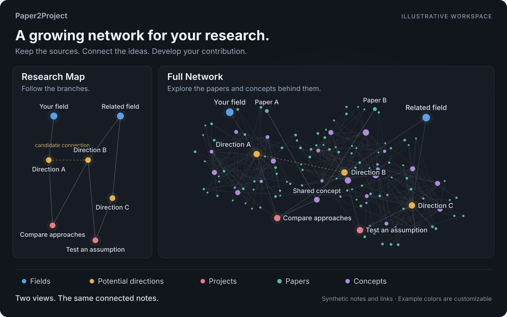

<h1 align="center">Paper2Project</h1>

<p align="center"><strong>Grow a research network from the papers you read.</strong></p>
<p align="center">A lightweight agent skill for connected research in Markdown and Obsidian.</p>

<p align="center">
  <a href="https://github.com/SAFuDarren/Paper2Project/actions/workflows/tests.yml"></a>
  <a href="LICENSE"></a>
  
</p>

<p align="center">
  <a href="#quickstart">Quickstart</a> · <a href="#how-it-is-organized">Workspace</a> · <a href="#make-it-yours">Preferences</a> · <a href="README.zh-CN.md">简体中文</a>
</p>



*Illustrative network with synthetic notes and links. This is a visual example of the organization, not an application screenshot. Real research connections require source support.*

Connect what you have read to questions you can investigate. Paper2Project helps an agent maintain source-grounded paper notes, reusable concepts, potential directions and concrete projects in one navigable workspace.

## What you get

- **Papers you can return to.** Capture the question, assumptions, method, results, argument chain and relation to your work, with original source links.
- **Ideas that connect.** Reuse shared concepts and explain the relationships between notes; backlinks make the same knowledge useful across projects.
- **A place for your contribution.** Give each project one home, with separate records for its problem, methods, results and possible extensions.
- **Continuity across sessions.** Save reading preferences, rule entry points and task records so another agent can pick up the work.

## Two views of the same research

| View | What it shows | What it helps you see |
| --- | --- | --- |
| **Research Map** | Fields, potential directions and project homes | The broad branches, explained connections and where your work sits |
| **Full Network** | Those branches plus papers and concepts | The sources and shared ideas behind each connection |

Use the same recognized academic names and role colors in both views: **blue** fields, **warm gold** potential directions, **coral** projects, **teal** papers and **purple** concepts. Colors are configurable. Graphs reflect maintained links between Markdown notes; the illustration above is a reproducible example. Obsidian provides the native interactive graph.

### A simple example

Two papers approach the same question differently. Link **Paper A** and **Paper B** through a **shared concept** in Library, then open **Compare approaches** as a project to record your question, method and findings. **Test an assumption** can become a linked follow-up project.

The diagram uses neutral field and direction labels so you can imagine your own research in their place. Use your discipline's recognized names in the actual workspace.

## How it is organized

**Library holds existing knowledge. Projects holds research you can develop.** Both follow the same discipline and field hierarchy. Classify papers by their subject, and link to the same project home wherever disciplines intersect.

```text
Academic/
├── Library/
│   └── <Discipline>/<Field>/
│       ├── Papers/
│       │   └── <Recognized subfield> - <Paper title>.md
│       └── Concepts/
└── Projects/
    └── <Discipline>/<Field>/
        ├── <Field> Research Directions.md
        └── <Project>/
            ├── <Project>.md
            ├── Problem/
            ├── Methods/
            ├── Results/
            └── Extensions/
```

The project home is a short index. Paper notes stay in Library and can support many projects. Create internal records when needed; keep each result's evidence and scope attached. A possible application remains a candidate until the missing bridge is checked.

## Quickstart

1. Download the repository, or clone it into a folder named `paper2project`:

   ```sh
   git clone https://github.com/SAFuDarren/Paper2Project.git paper2project
   ```

2. Place that folder in your agent's skill directory, or ask a compatible agent to read [SKILL.md](SKILL.md). The helper commands require **Python 3.10+**, using only the standard library.

3. Invoke the skill with your research context:

   ```text
   Use $paper2project to organize my research workspace.
   Use the research context and reading preferences already available to you.
   Start with a small structure and preserve my existing notes.
   ```

On first use, the agent reuses available context and relevant memory, proposes a suitable structure and asks only for consequential missing choices. Downloading the repository itself runs no setup. Existing workspaces follow a preservation and link-checking workflow; the initializer is for an empty workspace.

## Make it yours

Set response language, ordered note languages and filename language separately. The host LLM supplies preferences from context or memory it actually has; the program validates and saves the selected settings in `.paper2project.json`.

**Current request → saved settings → supplied memory → conversation → defaults.**

Customize reading depth, navigation, folder display names and the five role colors. Temporary requests affect the current task; enduring changes update the saved profile with backup and conflict checks. Existing notes keep their language and location until an explicit migration.

Built-in label packs cover **English, simplified and traditional Chinese, Spanish, French, German, Japanese and Arabic**. Use one language or several in your preferred order. Additional languages can use a complete custom label pack; the agent supplies and reviews the actual prose. See [setup and preference changes](references/onboarding.md).

## Go further

| Guide | Use it for |
| --- | --- |
| [First use and preferences](references/onboarding.md) | Context-aware setup, language selection and later changes |
| [Reading and research workflow](references/workflow.md) | Paper cards, concepts, opportunities and project records |
| [Maps and links](references/links-and-graphs.md) | Graph roles, supported connections and migration checks |
| [Rules and task handoff](references/preferences-and-handoff.md) | Stable entry points and continuity between agents |
| [Examples](examples/) | Small preference signals and a multilingual note card |
| [Extension contracts](references/extensions.md) | Optional embedding, RAG, agent and knowledge-store interfaces |

<details>
<summary><strong>Helper commands and tests</strong></summary>

Run these from the skill folder:

```sh
python scripts/p2p.py --help
python scripts/p2p.py locales
python scripts/p2p.py check --root /path/to/Academic
python scripts/p2p.py export --root /path/to/Academic --output /path/to/notes.jsonl
python -m unittest discover -s tests -v
```

GitHub Actions tests **Linux, macOS and Windows × Python 3.10, 3.12 and 3.14**. Checks cover structure, local links, identity, language handling and guarded writes. Source reading, scientific judgment and translation quality remain the agent's responsibility.

To reproduce the two README illustrations: `python scripts/render_readme_graph.py`. They use only synthetic data and the default role palette.

</details>

Embedding, RAG and external knowledge stores remain optional interfaces, disabled by default. The core workflow uses Markdown files and local helper commands.

[MIT license](LICENSE).
