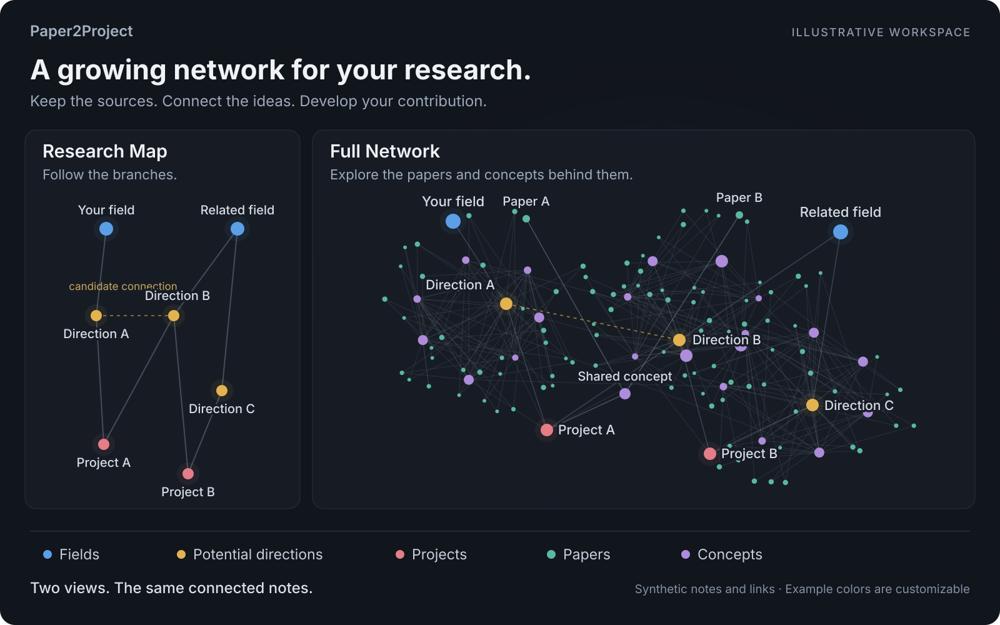

<h1 align="center">Paper2Project</h1>

<p align="center"><strong>Grow a research network from the papers you read.</strong></p>
<p align="center">A lightweight agent skill for connected research in Markdown and Obsidian.</p>

<p align="center">
  <a href="https://github.com/SAFuDarren/Paper2Project/actions/workflows/tests.yml"></a>
  <a href="LICENSE"></a>
  
</p>

<p align="center">
  <a href="#quickstart">Quickstart</a> · <a href="#how-it-is-organized">Workspace</a> · <a href="#make-it-yours">Preferences</a> · <a href="#updating">Updating</a> · <a href="README.zh-CN.md">简体中文</a>
</p>



*Illustrative network with synthetic notes and links. This is a visual example of the organization, not an application screenshot. Real research connections require source support.*

Connect what you have read to questions you can investigate. Paper2Project helps an agent maintain source-grounded paper notes, reusable concepts, potential directions and concrete projects in one navigable workspace.

## What you get

- **Papers you can return to.** Each note captures the question, assumptions, method, results, argument chain and relation to your work, with the original source link, reading scope and page locations.
- **Your PDFs, kept safe.** Hand over a folder of PDFs: duplicates and identifiers are found, text is extracted for reading, and each original is copied beside its note or linked where it already is. Your files are never moved or changed.
- **Your results, cited exactly.** Point to your results repository; project records cite its files at a pinned commit.
- **Connections with evidence.** Every substantive link between directions, projects or concepts records what the literature shows, why it matters for your work and what is still missing.
- **Ready in Obsidian from the first run.** Research Map and Full Network graph views are bookmarked, and every paper is reachable from its field index.
- **Search what you already have.** Full-text search over notes and PDFs, with line and page locations; semantic search when you connect an embedding model.
- **Continuity and safe updates.** Another agent picks up from the same entry point, and updating the skill keeps your customizations.

## Two views of the same research

| View | What it shows | What it helps you see |
| --- | --- | --- |
| **Research Map** | Fields, potential directions and project homes | The broad branches, explained connections and where your work sits |
| **Full Network** | Those branches plus papers and concepts | The sources and shared ideas behind each connection |

Use the same recognized academic names and role colors in both views: **blue** fields, **warm gold** potential directions, **coral** projects, **teal** papers and **purple** concepts. Colors are configurable. Graphs reflect maintained links between Markdown notes; the illustration above is a reproducible example. Obsidian provides the native interactive graph.

### A simple example

**Paper A** and **Paper B** link to a **shared concept** in Library. **Project A** and **Project B** can both reference those notes while keeping their own problem, methods, results and extensions in Projects.

The diagram uses neutral field and direction labels so you can imagine your own research in their place. Use your discipline's recognized names in the actual workspace.

## How it is organized

**Library holds existing knowledge. Projects holds research you can develop.** Both follow the same discipline and field hierarchy. Classify papers by their subject, and link to the same project home wherever disciplines intersect. Put the workspace in any folder of your vault; the structure inside it is fixed and checked.

```text
Academic/
├── Academic Home.md
├── Library/
│   └── <Discipline>/<Field>/
│       ├── <Field>.md                      field index (links are generated)
│       ├── Papers/
│       │   └── <Recognized subfield> - <Short title>.md
│       ├── PDFs/
│       │   └── <same name as the paper note>.pdf
│       └── Concepts/
├── Projects/
│   └── <Discipline>/<Field>/<Direction>/
│       ├── <Direction>.md
│       └── <Project>/
│           ├── <Project>.md                project home
│           ├── Problem/
│           ├── Methods/
│           ├── Results/
│           └── Extensions/
└── .maintenance/                           registers, snapshots and the search index
```

The project home is a short index. Paper notes stay in Library and can support many projects. Create internal records when needed; keep each result's evidence and scope attached. A possible application remains a candidate until the missing bridge is checked.

## Quickstart

1. Download the repository, or clone it into a folder named `paper2project`:

   ```sh
   git clone https://github.com/SAFuDarren/Paper2Project.git paper2project
   ```

2. Place that folder in your agent's skill directory, or ask a compatible agent to read [SKILL.md](SKILL.md). The helper commands need **Python 3.10+** and only the standard library. For the best PDF text, optionally install [PyMuPDF](https://pymupdf.readthedocs.io/) (`pip install pymupdf`) or poppler's `pdftotext`; otherwise a built-in reader is used.

3. Invoke the skill with what you have:

   ```text
   Use $paper2project to build my research workspace in <folder>.
   My papers are in <folder of PDFs>; my results are in <repository>.
   ```

   ```text
   Use $paper2project to organize my existing research notes in <folder>.
   Preserve my notes; adopt them and connect them.
   ```

The agent reuses available context, asks only for consequential missing choices, and works until `check` reports the workspace complete: structure, graph views, notes with their originals, cited results and indexed links. It reads and judges the sources; the helper commands do everything that follows from rules, such as paths, IDs, index links, tags, moves and bookmarks. Downloading the repository runs nothing by itself.

### Updating

Download the new release to a separate folder and let it update your installed copy. Files you edited are kept (the new version is written beside them as `.new`), and your own files and `local/` are never touched:

```sh
python <new-download>/scripts/update_skill.py --target <installed skill> --apply
python scripts/p2p.py upgrade --root <workspace> --apply
```

Extension settings such as embedding models or databases stay in your workspace profile across updates. See [updating without losing customizations](references/updates.md).

## Discover before adding

Ask for more research directions, related papers, or application cases for a project. Paper2Project checks the local Library and active review packets, and renders one complete chat card for each new source. Existing sources can be brief. Choose materials and project connections separately before any addition. See [discovery and review](references/discovery.md).

## Make it yours

Set response language, ordered note languages and filename language separately. The host LLM supplies preferences from context or memory it actually has; the program validates and saves the selected settings in `.paper2project.json`.

**Current request → saved settings → supplied memory → conversation → defaults.**

Customize reading depth, navigation, folder display names and the five role colors. Temporary requests affect the current task; enduring changes update the saved profile with backup and conflict checks. Existing notes keep their language and location until an explicit migration.

Built-in label packs cover **English, simplified and traditional Chinese, Spanish, French, German, Japanese and Arabic**. Use one language or several in your preferred order. Additional languages can use a complete custom label pack; the agent supplies and reviews the actual prose. See [setup and preference changes](references/onboarding.md).

## Go further

| Guide | Use it for |
| --- | --- |
| [First use and preferences](references/onboarding.md) | Context-aware setup, adopting existing notes, language selection |
| [PDFs and existing results](references/pdfs-and-results.md) | From a folder of PDFs and a results repository to a finished workspace |
| [Search](references/retrieval.md) | Searching notes and PDFs, optional semantic search |
| [Reading and research workflow](references/workflow.md) | Paper cards, concepts, opportunities and project records |
| [Maps and links](references/links-and-graphs.md) | Graph views, generated indexes and recorded connections |
| [Rules and task handoff](references/preferences-and-handoff.md) | Briefs, snapshots and continuity between agents |
| [Updating](references/updates.md) | Safe updates and the compatibility contract |
| [Extension contracts](references/extensions.md) | Your own embedding, RAG, agent or database integrations |
| [Examples](examples/) | Preference signals, note cards, evidence and a recorded connection |

<details>
<summary><strong>Helper commands and tests</strong></summary>

Run these from the skill folder; every writing command previews until you add `--apply`:

```sh
python scripts/p2p.py --help
python scripts/p2p.py init --root <workspace> --profile profile.json --non-interactive --apply
python scripts/p2p.py pdfs scan --root <workspace> --from <folder of PDFs>
python scripts/p2p.py render --root <workspace> --kind paper --input card.json --apply
python scripts/p2p.py repo scan --path <results repository>
python scripts/p2p.py relate --root <workspace> --plan relations.json --apply
python scripts/p2p.py check --root <workspace>
python scripts/p2p.py brief --root <workspace>
python scripts/retrieve.py search --root <workspace> "your question"
python -m unittest discover -s tests -v
```

GitHub Actions tests **Linux, macOS and Windows × Python 3.10–3.14**. Each of the 15 combinations runs the full suite twice with different hash seeds and verifies reproducible README illustrations. The suite includes an end-to-end run from PDFs and a results repository to a complete workspace. Checks cover structure, links, identity, originals, recorded connections, language handling and guarded writes. Source reading, scientific judgment and translation quality remain the agent's responsibility.

To reproduce the two README illustrations: `python scripts/render_readme_graph.py`. They use only synthetic data and the default role palette.

</details>

Everything runs locally on Markdown files. Search works without any model; embedding, RAG and external stores are used only when you configure them, and your configuration survives updates.

[MIT license](LICENSE).
