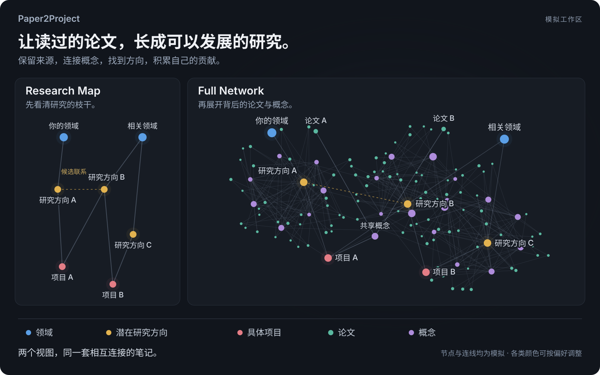

<h1 align="center">Paper2Project</h1>

<p align="center"><strong>让读过的论文，长成可以发展的研究。</strong></p>
<p align="center">面向 Markdown 与 Obsidian 的轻量科研管理 agent skill。</p>

<p align="center">
  <a href="https://github.com/SAFuDarren/Paper2Project/actions/workflows/tests.yml"></a>
  <a href="LICENSE"></a>
  
</p>

<p align="center">
  <a href="#开始使用">开始使用</a> · <a href="#目录怎么组织">目录结构</a> · <a href="#按你的偏好调整">自定义偏好</a> · <a href="#更新">更新</a> · <a href="README.md">English</a>
</p>



*图中节点与连线均为模拟，用于说明组织方式，并非应用截图。真实研究联系需要对应的来源依据。*

把读过的内容，连接到可以继续研究的问题。Paper2Project 帮助 agent 在同一个工作区中管理有来源的论文笔记、可复用概念、潜在研究方向和具体项目。

## 能帮助你做什么

- **让论文笔记值得回看。** 记录研究问题、基本假设、方法、结果、论证链路及与自己工作的联系，保留原始来源链接、阅读范围和页码定位。
- **PDF 原文安全保管。** 交出一个 PDF 文件夹：自动找出重复文件和 DOI/arXiv 编号，抽取文字供阅读，原文复制到笔记旁或在原位置链接。你的文件不会被移动或修改。
- **成果引用到具体版本。** 指向自己的成果仓库，项目记录按固定 commit 引用其中的文件。
- **每条联系都有证据。** 方向、项目、概念之间的实质联系，都写明文献事实、与我们工作的关系和尚缺的步骤。
- **第一次使用就能在 Obsidian 里看到。** 自动建好 Research Map 与 Full Network 两个图谱书签，每篇论文都能从所属领域索引到达。
- **检索已有内容。** 对笔记和 PDF 全文检索，结果定位到行或页；接入 embedding 模型后可做语义检索。
- **接得上，也更新得了。** 其他 agent 从同一入口接手；更新 skill 时保留你的定制。

## 同一套研究，两个视图

| 视图 | 展示什么 | 帮助理解什么 |
| --- | --- | --- |
| **Research Map** | 领域、潜在研究方向和项目入口 | 主要枝干、已有依据的联系，以及自己的工作处在哪里 |
| **Full Network** | 在枝干上展开论文与概念 | 每条联系背后的来源与共享知识 |

两个视图沿用同一套主流学术名称和角色配色：**蓝色**为领域、**暖金**为潜在研究方向、**珊瑚红**为具体项目、**青绿**为论文、**紫色**为概念。配色可调整。图谱来自 Markdown 笔记中持续维护的链接；上图是可复现的示例，原生交互图由 Obsidian 提供。

### 一个简单例子

Library 中的**论文 A** 与**论文 B**连接到同一个**共享概念**。**项目 A** 和**项目 B**都可以引用这些笔记，并在 Projects 中分别记录自己的问题、方法、结果和潜在延伸。

图中采用中性的领域与方向标签，方便代入自己的研究。实际工作区仍使用所属学科公认的名称。

## 目录怎么组织

**Library 保存已有知识，Projects 保存可以发展的研究。** 两边采用一致的学科与领域层级。论文按其研究内容归类；跨领域项目始终引用同一个项目入口。工作区可以放在库里任意文件夹，文件夹内部结构固定并由程序检查。

```text
Academic/
├── Academic Home.md
├── Library/
│   └── <学科>/<领域>/
│       ├── <领域>.md                       领域索引（链接由程序生成）
│       ├── Papers/
│       │   └── <公认的小方向> - <简短标题>.md
│       ├── PDFs/
│       │   └── <与论文笔记同名>.pdf
│       └── Concepts/
├── Projects/
│   └── <学科>/<领域>/<研究方向>/
│       ├── <研究方向>.md
│       └── <项目>/
│           ├── <项目>.md                   项目主页
│           ├── Problem/
│           ├── Methods/
│           ├── Results/
│           └── Extensions/
└── .maintenance/                           登记文件、快照与检索索引
```

项目主文件是简洁索引，论文资料统一放在 Library，供多个项目引用。内部记录按实际需要建立，每项结果保留证据与适用范围。潜在应用在完成关键桥接检查之前，继续标为候选。

## 开始使用

1. 下载仓库，或克隆为名叫 `paper2project` 的文件夹：

   ```sh
   git clone https://github.com/SAFuDarren/Paper2Project.git paper2project
   ```

2. 将文件夹放入 agent 的 skill 目录，或让兼容的 agent 阅读 [SKILL.md](SKILL.md)。辅助命令需要 **Python 3.10 及以上**，仅依赖标准库。想要更好的 PDF 文字效果，可选装 [PyMuPDF](https://pymupdf.readthedocs.io/)（`pip install pymupdf`）或 poppler 的 `pdftotext`；未安装时使用内置解析。

3. 按手头已有的内容调用：

   ```text
   使用 $paper2project 在 <文件夹> 建立我的科研工作区。
   我的论文在 <PDF 文件夹>，成果在 <仓库>。
   ```

   ```text
   使用 $paper2project 整理 <文件夹> 里已有的研究笔记。
   保留我的笔记，接入并连接起来。
   ```

agent 会利用已有背景，只询问会影响设计的关键缺项，并一直做到 `check` 报告工作区完成：结构、图谱视图、带原文的论文笔记、引用的成果和建好的索引链接。阅读与判断来源由 agent 完成；路径、ID、索引链接、标签、迁移、书签等由规则决定的步骤都由辅助命令完成。下载仓库本身不会运行任何东西。

### 更新

把新版下载到另一个文件夹，用它更新已安装的副本。你改过的文件会保留（新版写在旁边，后缀 `.new`），你自己的文件和 `local/` 不会被碰：

```sh
python <新下载>/scripts/update_skill.py --target <已安装的 skill> --apply
python scripts/p2p.py upgrade --root <工作区> --apply
```

embedding 模型、数据库等扩展配置保存在工作区配置中，更新后保持不变。详见[更新时保留定制](references/updates.md)。

## 发现与审核

想找项目的相关论文、潜在方向或应用案例时，Paper2Project 先核对学术库和待审批次。库外候选逐条生成完整的对话卡片，已有资料可以简报。论文收录和项目关联分别由你选择。见[发现与审核流程](references/discovery.md)。

## 按你的偏好调整

回复语言、笔记语言及其顺序、文件名语言分别设置。宿主 LLM 从它实际拥有的 context 或 memory 中提取偏好，程序验证后将选定设置保存在 `.paper2project.json`。

**当前明确要求 → 已保存设置 → 提供的 memory → 当前对话 → 默认值。**

阅读详细度、导航方式、目录显示名称和五类配色都可以调整。临时要求只影响本次任务；长期变更更新同一份配置，并带备份与冲突检查。已有笔记保留自己的语言和位置，迁移时另行处理。

内置 **英语、简体中文、繁体中文、西班牙语、法语、德语、日语和阿拉伯语**标签包，可选择单语或按指定顺序使用多种语言。其他语言可补充完整的自定义标签包，正文由 agent 提供并核对。详见[首次使用与偏好调整](references/onboarding.md)。

## 按需继续了解

| 文档 | 用途 |
| --- | --- |
| [首次使用与偏好](references/onboarding.md) | 基于背景设计、接入已有笔记、选择语言 |
| [PDF 与已有成果](references/pdfs-and-results.md) | 从 PDF 文件夹和成果仓库到完成的工作区 |
| [检索](references/retrieval.md) | 检索笔记与 PDF，可选语义检索 |
| [阅读与研究流程](references/workflow.md) | 论文卡片、概念、潜在方向与项目记录 |
| [图谱与链接](references/links-and-graphs.md) | 图谱视图、生成的索引与登记的联系 |
| [规则与任务交接](references/preferences-and-handoff.md) | 工作简报、快照与跨 agent 接手 |
| [更新](references/updates.md) | 安全更新与兼容约定 |
| [拓展接口](references/extensions.md) | 自己的 embedding、RAG、agent 或数据库接入 |
| [示例](examples/) | 偏好输入、笔记卡片、成果引用与一条登记的联系 |

<details>
<summary><strong>辅助命令与测试</strong></summary>

在 skill 文件夹中运行；所有写入命令在加 `--apply` 之前都只预览：

```sh
python scripts/p2p.py --help
python scripts/p2p.py init --root <工作区> --profile profile.json --non-interactive --apply
python scripts/p2p.py pdfs scan --root <工作区> --from <PDF 文件夹>
python scripts/p2p.py render --root <工作区> --kind paper --input card.json --apply
python scripts/p2p.py repo scan --path <成果仓库>
python scripts/p2p.py relate --root <工作区> --plan relations.json --apply
python scripts/p2p.py check --root <工作区>
python scripts/p2p.py brief --root <工作区>
python scripts/retrieve.py search --root <工作区> "你的问题"
python -m unittest discover -s tests -v
```

GitHub Actions 覆盖 **Linux、macOS、Windows × Python 3.10–3.14**。15 组组合各使用两个不同的哈希种子运行完整测试，并核对 README 配图的生成结果可复现。测试包含一次从 PDF 和成果仓库到完整工作区的端到端流程。程序检查结构、链接、标识、原文、登记的联系、语言处理和受保护的写入。来源阅读、科学判断与翻译质量仍由 agent 负责。

运行 `python scripts/render_readme_graph.py` 可以复现两张 README 配图。配图只使用模拟数据和默认角色配色。

</details>

全部在本地基于 Markdown 文件运行。检索不需要任何模型；embedding、RAG 和外部知识库只在你配置后使用，配置在更新后保持不变。

[MIT 许可证](LICENSE)。
