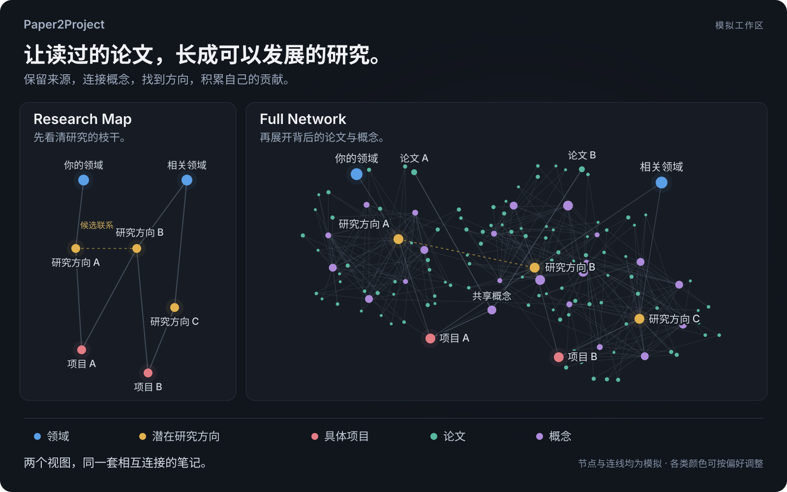

<h1 align="center">Paper2Project</h1>

<p align="center"><strong>让读过的论文，长成可以发展的研究。</strong></p>
<p align="center">面向 Markdown 与 Obsidian 的轻量科研管理 agent skill。</p>

<p align="center">
  <a href="https://github.com/SAFuDarren/Paper2Project/actions/workflows/tests.yml"></a>
  <a href="LICENSE"></a>
  
</p>

<p align="center">
  <a href="#开始使用">开始使用</a> · <a href="#目录怎么组织">目录结构</a> · <a href="#按你的偏好调整">自定义偏好</a> · <a href="README.md">English</a>
</p>



*图中节点与连线均为模拟，用于说明组织方式，并非应用截图。真实研究联系需要对应的来源依据。*

把读过的内容，连接到可以继续研究的问题。Paper2Project 帮助 agent 在同一个工作区中管理有来源的论文笔记、可复用概念、潜在研究方向和具体项目。

## 能帮助你做什么

- **让论文笔记值得回看。** 记录研究问题、基本假设、方法、结果、论证链路及与自己工作的联系，保留原始来源链接。
- **让知识相互连接。** 多个项目共用概念笔记，点与点之间说明实际关系，再通过反向链接继续探索。
- **把自己的增量整理清楚。** 每个项目只有一个主入口，内部把问题、方法、结果和潜在延伸分开记录。
- **让下一次工作接得上。** 保存阅读偏好、规则入口和任务记录，方便其他 agent 接手。

## 同一套研究，两个视图

| 视图 | 展示什么 | 帮助理解什么 |
| --- | --- | --- |
| **Research Map** | 领域、潜在研究方向和项目入口 | 主要枝干、已有依据的联系，以及自己的工作处在哪里 |
| **Full Network** | 在枝干上展开论文与概念 | 每条联系背后的来源与共享知识 |

两个视图沿用同一套主流学术名称和角色配色：**蓝色**为领域、**暖金**为潜在研究方向、**珊瑚红**为具体项目、**青绿**为论文、**紫色**为概念。配色可调整。图谱来自 Markdown 笔记中持续维护的链接；上图是可复现的示例，原生交互图由 Obsidian 提供。

### 一个简单例子

Library 中的**论文 A** 与**论文 B**连接到同一个**共享概念**。**项目 A** 和**项目 B**都可以引用这些笔记，并在 Projects 中分别记录自己的问题、方法、结果和潜在延伸。

图中采用中性的领域与方向标签，方便代入自己的研究。实际工作区仍使用所属学科公认的名称。

## 目录怎么组织

**Library 保存已有知识，Projects 保存可以发展的研究。** 两边采用一致的学科与领域层级。论文按其研究内容归类；跨领域项目始终引用同一个项目入口。

```text
Academic/
├── Library/
│   └── <学科>/<领域>/
│       ├── Papers/
│       │   └── <公认的小方向> - <论文标题>.md
│       └── Concepts/
└── Projects/
    └── <学科>/<领域>/
        ├── <领域> Research Directions.md
        └── <项目>/
            ├── <项目>.md
            ├── Problem/
            ├── Methods/
            ├── Results/
            └── Extensions/
```

项目主文件是简洁索引，论文资料统一放在 Library，供多个项目引用。内部记录按实际需要建立，每项结果保留证据与适用范围。潜在应用在完成关键桥接检查之前，继续标为候选。

## 开始使用

1. 下载仓库，或克隆为名叫 `paper2project` 的文件夹：

   ```sh
   git clone https://github.com/SAFuDarren/Paper2Project.git paper2project
   ```

2. 将文件夹放入 agent 的 skill 目录，或让兼容的 agent 阅读 [SKILL.md](SKILL.md)。辅助命令需要 **Python 3.10 及以上**，仅依赖标准库。

3. 结合你的研究背景调用：

   ```text
   使用 $paper2project 整理我的科研工作区。
   结合你已经知道的研究背景和阅读偏好来设计。
   从简洁的结构开始，保留我已有的笔记。
   ```

首次调用时，agent 利用已有 context 与实际可用的相关 memory，提出合适的结构，只询问会影响设计的关键缺项。下载本身不会启动设置。已有库遵循保留内容和检查迁移链接的流程；初始化程序只用于空工作区。

## 按你的偏好调整

回复语言、笔记语言及其顺序、文件名语言分别设置。宿主 LLM 从它实际拥有的 context 或 memory 中提取偏好，程序验证后将选定设置保存在 `.paper2project.json`。

**当前明确要求 → 已保存设置 → 提供的 memory → 当前对话 → 默认值。**

阅读详细度、导航方式、目录显示名称和五类配色都可以调整。临时要求只影响本次任务；长期变更更新同一份配置，并带备份与冲突检查。已有笔记保留自己的语言和位置，迁移时另行处理。

内置 **英语、简体中文、繁体中文、西班牙语、法语、德语、日语和阿拉伯语**标签包，可选择单语或按指定顺序使用多种语言。其他语言可补充完整的自定义标签包，正文由 agent 提供并核对。详见[首次使用与偏好调整](references/onboarding.md)。

## 按需继续了解

| 文档 | 用途 |
| --- | --- |
| [首次使用与偏好](references/onboarding.md) | 基于背景设计、选择语言及后续调整 |
| [阅读与研究流程](references/workflow.md) | 论文卡片、概念、潜在方向与项目记录 |
| [图谱与链接](references/links-and-graphs.md) | 图谱角色、联系依据和迁移检查 |
| [规则与任务交接](references/preferences-and-handoff.md) | 稳定入口与跨 agent 接手 |
| [示例](examples/) | 小型偏好输入与多语言笔记卡片 |
| [拓展接口](references/extensions.md) | 可选的 embedding、RAG、agent 与知识库接入 |

<details>
<summary><strong>辅助命令与测试</strong></summary>

在 skill 文件夹中运行：

```sh
python scripts/p2p.py --help
python scripts/p2p.py locales
python scripts/p2p.py check --root /path/to/Academic
python scripts/p2p.py export --root /path/to/Academic --output /path/to/notes.jsonl
python -m unittest discover -s tests -v
```

GitHub Actions 覆盖 **Linux、macOS、Windows × Python 3.10–3.14**。15 组组合各使用两个不同的哈希种子运行完整测试，并核对 README 配图的生成结果可复现。程序检查结构、本地链接、标识、语言处理和受保护的写入。来源阅读、科学判断与翻译质量仍由 agent 负责。

运行 `python scripts/render_readme_graph.py` 可以复现两张 README 配图。配图只使用模拟数据和默认角色配色。

</details>

Embedding、RAG 和外部知识库保留为可选接口，默认关闭。核心流程使用 Markdown 文件和本地辅助命令。

[MIT 许可证](LICENSE)。
